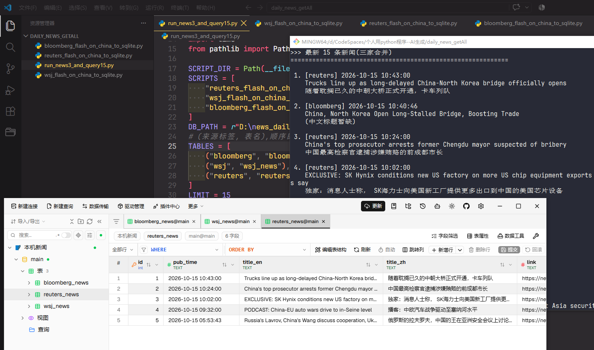
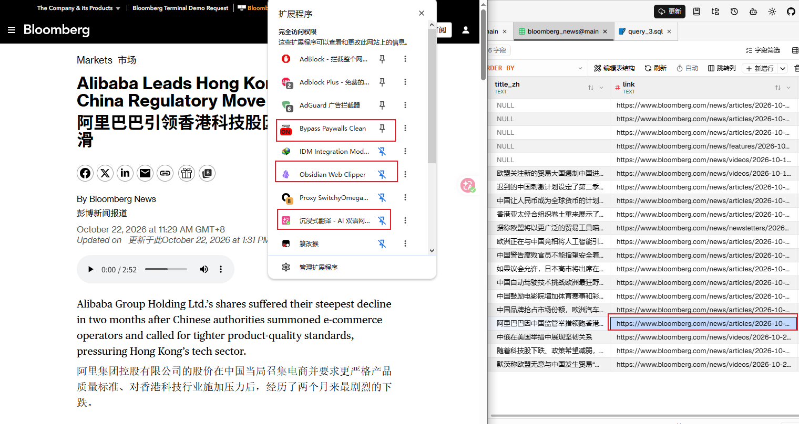
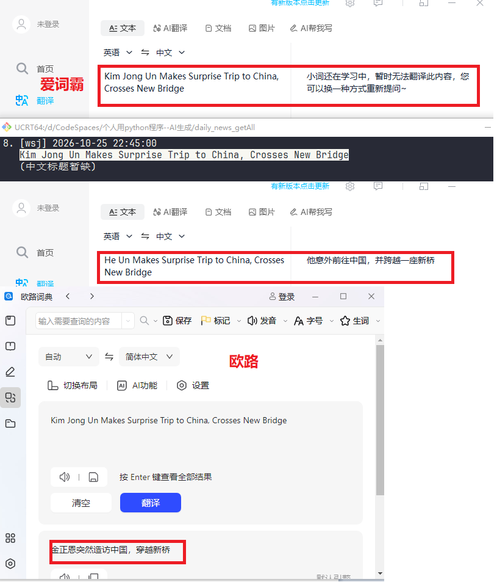

# daily_news_getAll

注：数据库中保存有文字链接，如果想看全文，建议电脑浏览器安装bypass-paywalls-clean插件，（和沉浸式翻译插件），这样打开链接后就能看到全文了。

功能：从全球各大媒体，根据RSS获取标题中与中国相关的内容（需要科学上网）。

注：所有代码由Claude完成，全部免费使用。

特点：标题自动翻译为中文，使用免费翻译。不要摘要。保存到本地D盘下的数据库中，用的是sqlite数据库。

执行：依次执行三个抓取程序(路透社 -> 华尔街日报 -> 彭博)，全部执行完后，从 D:\\news_daily.db 中合并三张表，显示最新 15 条。

注：另外附有不需要保存到sqlite数据库，而是保存到当前文件夹下按日期命名的md文件的程序。

注：另外一个文件夹下，有类似程序，获取ap、economist、nytimes、ft的关于中国的新闻，使用方法类似。

注：另外附有三个程序，其中

remove_duplicate_news.py：去掉重复内容。目前只有wsj会获取重复内容，我不清楚原因，暂时手动删除。

fill_missing_title_zh.py：查找并翻译中文标题为NULL的记录。

search_news.py：根据关键词查找新闻。


在win10上使用：

```powershell
sqlite3 --version
3.53.3 2026-06-26 20:14:12 d4c0e51e4aeb96955b99185ab9cde75c339e2c29c3f3f12428d364a10d782c62 (64-bit)

python --version
Python 3.13.7
```

涉及四个程序：

```

bloomberg_flash_on_china_to_sqlite.py
reuters_flash_on_china_to_sqlite.py
wsj_flash_on_china_to_sqlite.py
run_news3_and_query15.py

```

电脑连外网，最好是虚拟网卡模式，或者终端设置好网络代理。

执行run_news3_and_query15.py即可。

终端会显示如下效果：



数据库查看最新新闻对应的SQL语句：

使用DBX（数据库管理软件）连接并查看。可以执行这个sql语句。我已保存该sql到数据库的查询中。

```sql
SELECT 'bloomberg' AS src,
       pub_time,
       title_en,
       title_zh
FROM bloomberg_news
UNION ALL
SELECT 'wsj',
       pub_time,
       title_en,
       title_zh
FROM wsj_news
UNION ALL
SELECT 'reuters',
       pub_time,
       title_en,
       title_zh
FROM reuters_news
ORDER BY pub_time DESC
LIMIT 15;
```

关键词搜索新闻的SQL语句：

```sql
SELECT source, pub_time, title_en, title_zh, link
FROM (
    SELECT 'ap_news'        AS source, pub_time, title_en, title_zh, link FROM ap_news
    UNION ALL
    SELECT 'bloomberg_news' AS source, pub_time, title_en, title_zh, link FROM bloomberg_news
    UNION ALL
    SELECT 'economist_news' AS source, pub_time, title_en, title_zh, link FROM economist_news
    UNION ALL
    SELECT 'ft_news'        AS source, pub_time, title_en, title_zh, link FROM ft_news
    UNION ALL
    SELECT 'nytimes_news'   AS source, pub_time, title_en, title_zh, link FROM nytimes_news
    UNION ALL
    SELECT 'reuters_news'   AS source, pub_time, title_en, title_zh, link FROM reuters_news
    UNION ALL
    SELECT 'wsj_news'       AS source, pub_time, title_en, title_zh, link FROM wsj_news
) AS all_news
WHERE title_zh LIKE '%黄仁勋%'
   OR title_zh LIKE '%英伟达%'
   OR title_en LIKE '%Jensen Huang%'
   OR title_en LIKE '%Nvidia%'
ORDER BY pub_time DESC
LIMIT 15;


-- SQLite 的 LIKE 对 ASCII 字符默认不区分大小写，所以 %Nvidia% 能匹配 NVIDIA、nvidia。
-- AND 的优先级高于 OR。如果以后再加别的过滤条件（比如限定时间范围），必须把 OR 部分用括号包起来，否则逻辑会出错
-- WHERE (title_zh LIKE '%黄仁勋%'
--     OR title_zh LIKE '%英伟达%'
--     OR title_en LIKE '%Jensen Huang%'
--     OR title_en LIKE '%Nvidia%')
--   AND pub_time >= '2026-10-01'
```


附终端查看方法：

```powershell
sqlite3 D:\news_daily.db "SELECT 'bloomberg' AS src, pub_time, title_en, title_zh FROM bloomberg_news UNION ALL SELECT 'wsj', pub_time, title_en, title_zh FROM wsj_news UNION ALL SELECT 'reuters', pub_time, title_en, title_zh FROM reuters_news ORDER BY pub_time DESC LIMIT 20;"
```

查看全文示例图：




建议使用欧路词典翻译，不要使用爱词霸，这个爱词霸软件会故意根据英文内容选择性翻译：


