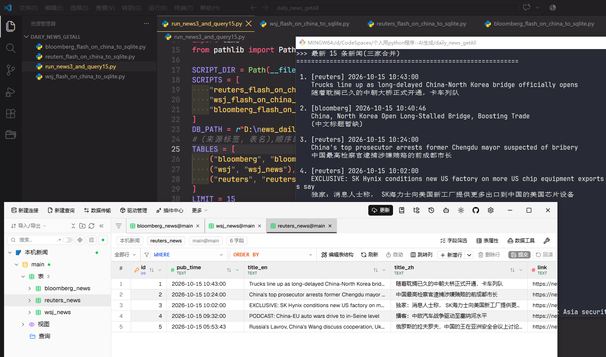
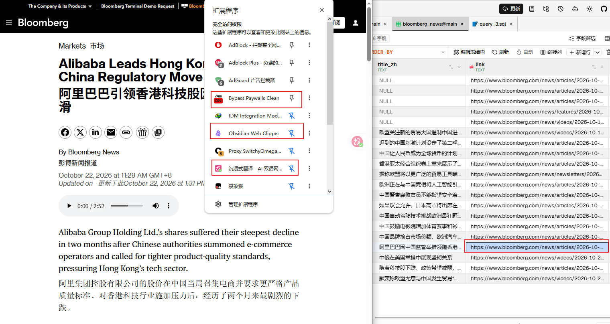

# daily_news_getAll

注：数据库中保存有文字链接，如何想看全文，建议电脑浏览器安装bypass-paywalls-clean插件，（和沉浸式翻译插件），这样打开链接后就能看到全文了。

根据RSS获取标题中与中国相关的内容（需要科学上网）。

标题自动翻译为中文，使用免费翻译。不要摘要。

保存到本地D盘下的数据库中，用的是sqlite数据库。

依次执行三个抓取程序(路透社 -> 华尔街日报 -> 彭博),

全部执行完后,从 D:\\news_daily.db 中合并三张表,显示最新 15 条。

在win10上使用:

```powershell
sqlite3 --version
3.53.3 2026-06-26 20:14:12 d4c0e51e4aeb96955b99185ab9cde75c339e2c29c3f3f12428d364a10d782c62 (64-bit)

python --version
Python 3.13.7
```

涉及四个程序:

```

bloomberg_flash_on_china_to_sqlite.py
reuters_flash_on_china_to_sqlite.py
wsj_flash_on_china_to_sqlite.py
run_news3_and_query15.py

```

电脑连外网，最好是虚拟网卡模式，或者终端设置好网络代理。

执行run_news3_and_query15.py即可。

终端会显示如下效果:



数据库查看:

使用DBX连接并查看。可以执行这个sql语句。我已保存该sql到数据库的查询中。

```sql
SELECT 'bloomberg' AS src,
       pub_time,
       title_en,
       title_zh
FROM bloomberg_news
UNION ALL
SELECT 'wsj',
       pub_time,
       title_en,
       title_zh
FROM wsj_news
UNION ALL
SELECT 'reuters',
       pub_time,
       title_en,
       title_zh
FROM reuters_news
ORDER BY pub_time DESC
LIMIT 20;
```

附终端查看方法

```powershell
sqlite3 D:\news_daily.db "SELECT 'bloomberg' AS src, pub_time, title_en, title_zh FROM bloomberg_news UNION ALL SELECT 'wsj', pub_time, title_en, title_zh FROM wsj_news UNION ALL SELECT 'reuters', pub_time, title_en, title_zh FROM reuters_news ORDER BY pub_time DESC LIMIT 20;"
```




