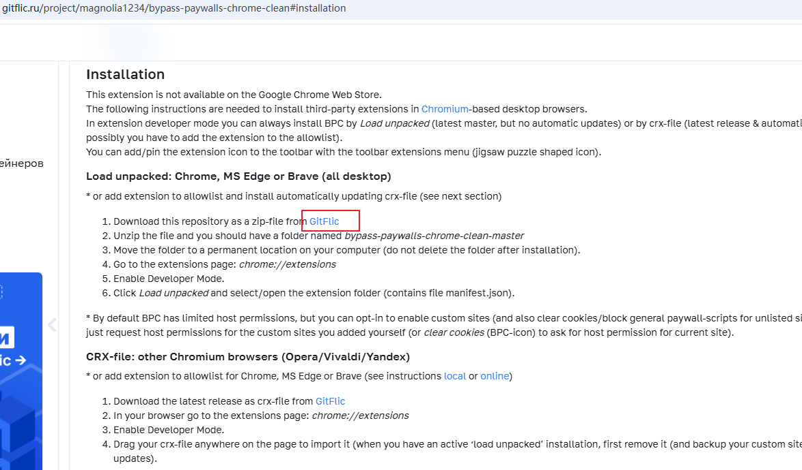
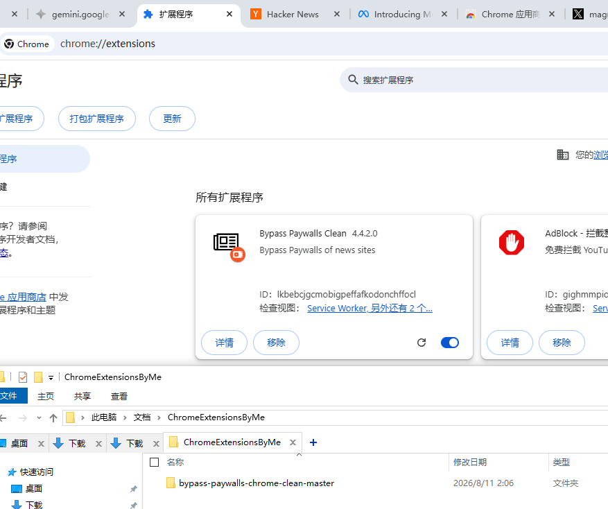

# bypass-paywalls-clean安装使用

//2026年4月1日


1.作者推特

https://x.com/Magnolia1234B

备用chrome下载网址

```
https://gitflic.ru/project/magnolia1234/bypass-paywalls-chrome-clean
```

2.下载安装

对于Firefox浏览器，下载xpi后缀的扩展，对于Chrome内核的浏览器下载zip压缩包，找个电脑固定位置解压，然后在浏览器扩展后安装即可。

```
bypass_paywalls_clean-4.3.3.7.xpi

bypass-paywalls-chrome-clean-master.zip
```

3.建议重点关注：彭博社和华尔街日报




